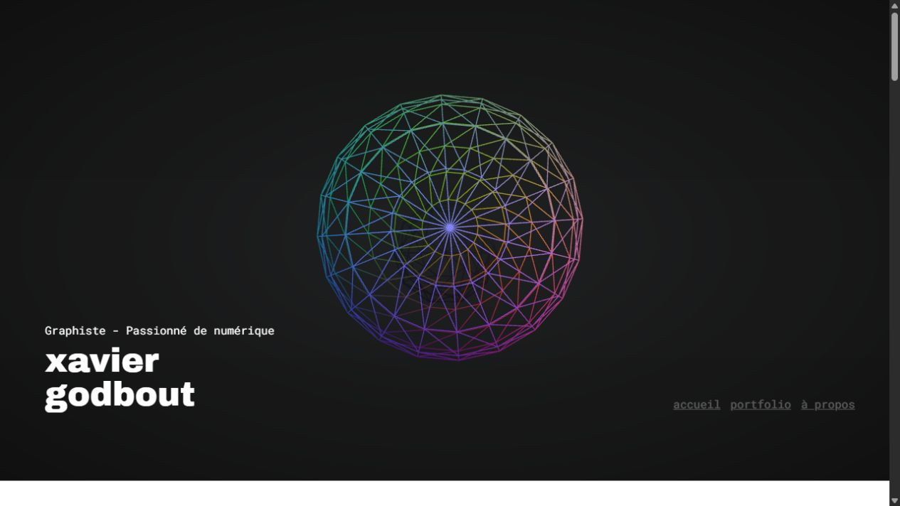

# Portfolio 2019

> Personal portfolio from 2019. I'll update it some day.

The French-language portfolio collects branding, web design, and graphic design projects. Individual project pages are in [`work/`](./work/).
